<p align="center">
  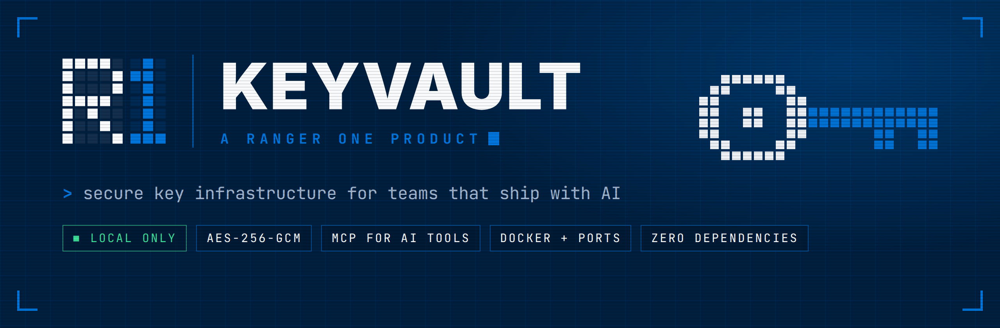
</p>

<p align="center">
  <a href="https://github.com/RangerOneSpace/keyvault/releases/latest"></a>
  <a href="LICENSE"></a>
  
  
  
</p>

<p align="center">
  <a href="https://github.com/RangerOneSpace/keyvault/releases/latest"><b>Download</b></a> &nbsp;·&nbsp;
  <a href="#install">Manual</a> &nbsp;·&nbsp;
  <a href="SECURITY.md">Security</a> &nbsp;·&nbsp;
  <a href="CHANGELOG.md">Changelog</a> &nbsp;·&nbsp;
  <a href="mailto:support@rangerone.io">Support</a>
</p>

---

**KeyVault is a local, encrypted home for your API keys that Claude, Codex, Cursor and other AI tools can use without ever seeing them.** It also gives you one screen for everything running on your machine: your apps, Docker containers and localhost ports.

LLM providers show you an API key once. After that it lives wherever you pasted it: a notes app, a Slack message, five different `.env` files. Run a few companies or clients and you soon lose track of which key belongs to whom, which are still live, and which should have been rotated months ago. KeyVault fixes that, and keeps the keys out of your AI's chat logs while you're at it.

<p align="center">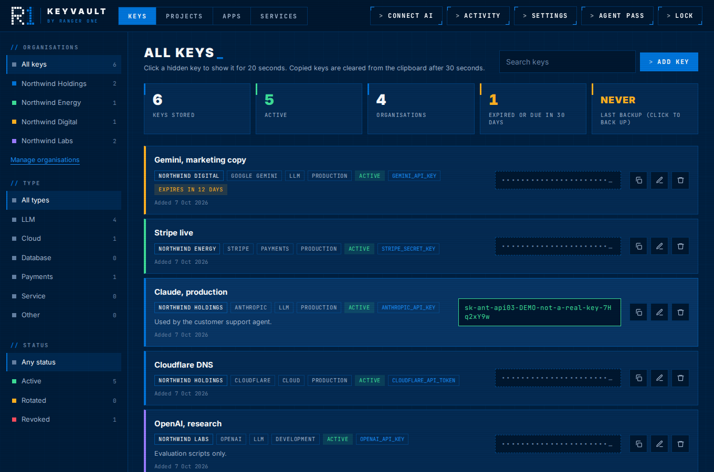</p>

| | |
|---|---|
| 🔑 **Keys, organised** | Every key with its organisation, provider, environment, status, expiry date and notes. Search, filter, reveal for 20 seconds, copy (the clipboard clears itself after 30). |
| 🤖 **AI uses keys, never sees them** | Through the [Model Context Protocol](https://modelcontextprotocol.io), your assistant sees key *names* and asks KeyVault to write a `.env` or run a command with them. The values never enter the conversation. |
| 🧪 **Package name checks** | Your AI can check a proposed dependency against a pinned [slopsquatting reference](data/README.md) and the official PyPI or npm registry before using it. A dataset match blocks the exact name; a registry listing does not mean the package is safe. |
| 🗂️ **Projects** | Every project with its folders, where you left off and what's next. Resume in one click, in Explorer, VS Code, Cursor or a terminal, or ask your AI to pick it up. |
| 🎬 **Apps** | Everything you have running, as cards you can open, stop or restart. Your dev servers and containers, with their own icons. |
| 🐳 **Services** | Docker containers by compose project, and every program on a localhost port. Start a compose project with keys injected straight from the vault, with no `.env` on disk. |
| 🔒 **Yours alone** | Stays on your computer, encrypted with AES-256. No account, no cloud, no telemetry, zero third-party runtime dependencies. MIT licensed. |

## The manual

| | Chapter | What's in it |
|---|---|---|
| 01 | [Install](#install) | Windows exe, macOS, Linux, npm, from source |
| 02 | [First run](#first-run) | Master password, organisations, your first key |
| 03 | [Everyday use](#everyday-use) | Revealing, copying, rotating, locking, signing in |
| 04 | [Projects](#projects) | Pick up any project where you left off, with you or your AI |
| 05 | [Apps](#apps) | The card view of everything running |
| 06 | [Services](#services) | Docker, ports, and compose with keys |
| 07 | [Connect your AI](#connect-your-ai) | Claude, Codex, Cursor, LM Studio, and what they can do |
| 08 | [Backups](#backups) | Encrypted backups and restoring |
| 09 | [How it works](#how-it-works) | Encryption, sessions, what the AI can and cannot reach |
| 10 | [Reference](#reference) | Commands and settings |
| 11 | [Troubleshooting](#troubleshooting) | When something doesn't behave |
| 12 | [Contribute](#contribute) | Building, testing, licence |

<br>

<a id="install"></a>
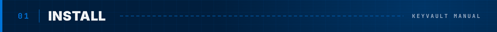

### Windows: one file, double-click

1. Download **KeyVault.exe** from the [latest release](https://github.com/RangerOneSpace/keyvault/releases/latest).
2. Move it somewhere permanent **before** you connect any AI tools, because they remember where it is. A good spot is `C:\Users\<you>\Apps\KeyVault\KeyVault.exe`. Pin it to Start or the taskbar if you like.
3. Double-click it. KeyVault starts in the background and opens in your browser. The small window that flashes up closes by itself.
4. When KeyVault asks **Start KeyVault when you sign in?**, click **Turn on**. From then on it is already running every time your computer starts, so you never have to open the exe again. (Change it any time in **Settings > Start with your computer**.)

> [!NOTE]
> KeyVault.exe is not code-signed yet, so Windows may say **"Windows protected your PC"** the first time. Click **More info**, then **Run anyway**. Every release lists the file's SHA-256 checksum so you can check your download with `Get-FileHash KeyVault.exe` in PowerShell.

The exe carries its own copy of Node.js, so there is nothing else to install. That is also why it is about 90 MB.

### macOS and Linux

Download the file for your system from the [latest release](https://github.com/RangerOneSpace/keyvault/releases/latest), make it executable with `chmod +x`, and run it. Or install with npm, below.

### With Node.js (any system)

You need [Node.js](https://nodejs.org) 20 or newer.

```sh
npm install -g github:RangerOneSpace/keyvault
keyvault
```

### From source

```sh
git clone https://github.com/RangerOneSpace/keyvault.git
cd keyvault
node bin/keyvault.js
```

There is no build step for running from source. To build the standalone executable yourself, run `npm install` then `npm run build:exe`. The output lands in `dist/`.

<br>

<a id="first-run"></a>
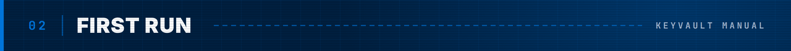

<p align="center">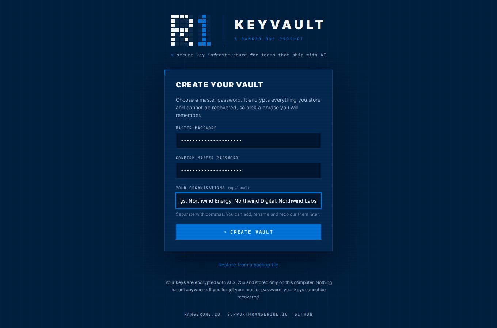</p>

1. **Choose a master password.** At least 10 characters. A short phrase such as *copper kettle morning* works well and is easy to remember.
2. **List your organisations**, separated by commas. These are the companies or clients your keys belong to. You can add, rename and recolour them later.
3. **Add your first key** with **Add key**. Type the provider (Anthropic, OpenAI, Stripe, Supabase...) and KeyVault fills in the type and the usual environment variable name for you.

> [!IMPORTANT]
> There is no password recovery. If you forget your master password, nobody can open your vault, including us. Download an encrypted backup as soon as you have added a few keys (**Settings > Download encrypted backup**).

<br>

<a id="everyday-use"></a>
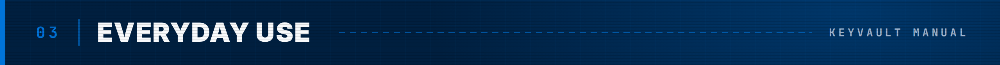

KeyVault keeps running in the background until you stop it or restart the computer, and with **Start with your computer** switched on it is back by itself after every restart. Your browser stays signed in, so you can simply bookmark **http://127.0.0.1:47821** and come back any time. New tabs open straight in. After a lock or a restart it asks for your master password again, nothing more.

| To... | Do this |
|---|---|
| Open KeyVault | Your bookmark, or double-click KeyVault.exe, or run `keyvault` |
| Start it automatically | **Settings > Start with your computer**, or `keyvault autostart on`. It starts hidden at sign-in; the vault stays locked until you unlock it. |
| See a key | Click the dotted box. It hides again after 20 seconds. |
| Copy a key | The copy icon. The clipboard is cleared after 30 seconds. |
| Record a rotation | Edit the key and paste the new value (leave it blank to keep the old one), or mark the old key **Rotated** and add the new one. |
| Track expiry | Set **Expires or rotate by**. Keys due within 30 days are flagged. |
| Organise | **Manage organisations** to add, rename or recolour. |
| Lock now | **Lock**, or `keyvault lock`. It also locks itself after a period without activity: 30 minutes by default, anything from 1 minute to 24 hours in **Settings**. |
| Let AI tools work while you're away | **Agent pass**, see below. |
| Sign out other browsers | **Settings > Running KeyVault > Sign out other browsers** |
| Stop KeyVault | **Settings > Stop KeyVault**, or `keyvault stop` |
| Export an inventory for an audit | **Settings > Export inventory**. A CSV of names, owners, providers and dates, and no key values. |

<br>

### Agent pass: overnight runs without leaving the vault open

KeyVault locks after a while without activity in its page, and AI tools using keys don't count as activity. That is safe, but it stops an agent halfway through an overnight job. An **agent pass** solves it.

<p align="center">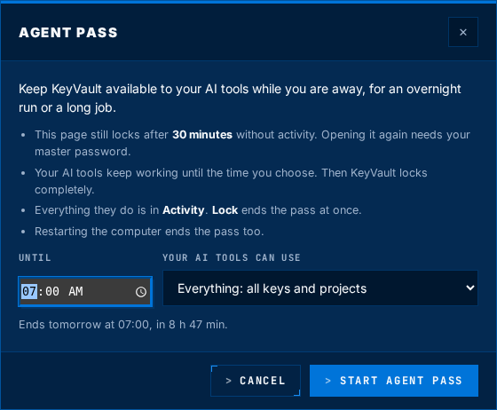</p>

1. Click **Agent pass** in the top bar.
2. Choose when it ends, for example 07:00, and what your AI tools can use: everything, or **only one project and the keys linked to it**.
3. Click **Start agent pass**. The button turns green and shows the end time.

While the pass runs, the KeyVault page still locks after the usual time, and opening it needs your master password. Your AI tools keep working with what the pass allows until the end time; then KeyVault locks completely. Everything they do is in **Activity**. **Lock**, or **End the pass and lock everything** on the lock screen, stops it at once. A pass lasts at most 24 hours, and restarting the computer ends it.

<a id="projects"></a>
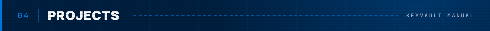

The **Projects** tab is a harness for everything you're working on. Each project holds its local folders, a note on **where you left off**, a **build checklist** that you and your AI keep up to date, links, the keys it uses and an activity log. When you come back, one click opens the folder and shows you exactly where you were.

<p align="center">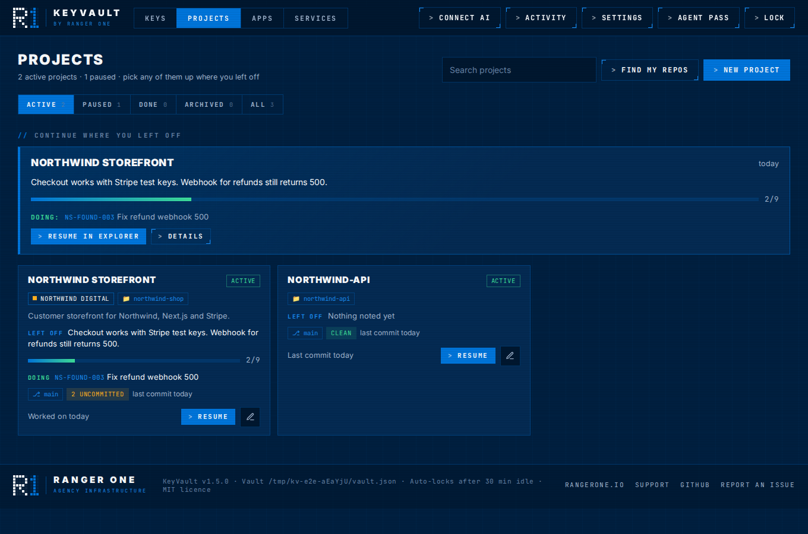</p>

- **Continue where you left off** at the top shows the active projects you worked on most recently, with your note, checklist progress and the item in progress or up next. **Resume** opens the folder and the project.
- **Each card** shows the project's organisation, folder, your note, checklist progress, the next item, and live git status: branch, uncommitted changes and the last commit.
- **Status** is Active, Paused, Done or Archived. Use the filter bar to switch between them.

### Creating projects

- **New project**: give it a name and a folder. On Windows, **Browse…** opens the normal folder picker.
- **Search GitHub…** (in **Find my repos**, and next to **Browse…** on a project's folders) finds a repo on GitHub: **My repos** lists yours and your organisations', private ones included, and **All of GitHub** searches everywhere. Each result says whether it is already on this computer. **Add as project** links the folder you have; **Clone and add** clones it into your code folder first. Inside a project, **Link folder** and **Clone and link** add it to that project.
- **Find my repos** looks for git repos in your usual code folders (`code`, `projects`, `Documents\GitHub` and others in your user folder), or any folder you point it at. Tick the ones you want, and each becomes a project in one go.

### The checklist

<p align="center">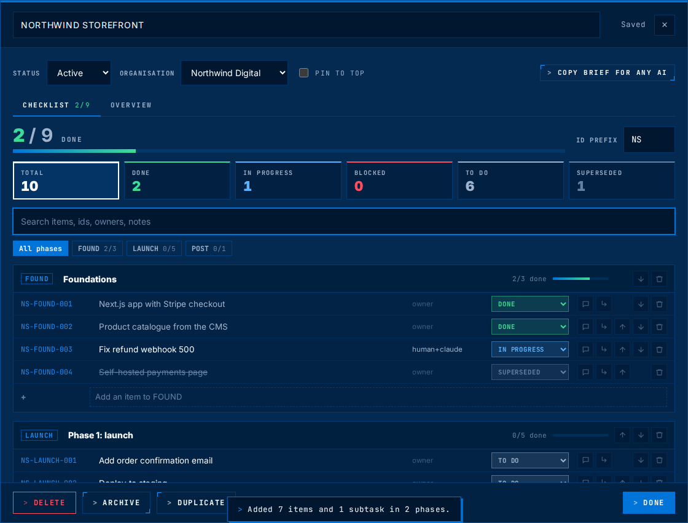</p>

Every project opens on its checklist: the whole plan, phase by phase, with live progress.

- **Phases** group the work, like *Foundations* or *Phase 1: launch*. Each has a short code that starts its item ids.
- **Items** get an id such as `NS-FOUND-003` (the project's ID prefix, the phase code, a number), a **status** (To do, In progress, Done, Blocked, Superseded), an **owner** (you, `claude`, `human+claude`, anyone) and optional notes.
- **The totals** across the top double as filters: click **Blocked** to see only what is stuck. Search covers titles, ids, owners and notes, and the phase chips narrow it to one phase.
- **Subtasks** break an item into smaller steps, one level deep, with ids like `NS-FOUND-003.1`. Use the subtask button on an item, or indent lines when you paste a list. The parent shows how many are done and can fold them away.
- **Superseded** items stay on record but do not count towards progress, so a changed plan never makes you look behind.
- **Add** an item at the bottom of any phase, add a phase below the list, or **Paste a list…** you already have (a line ending in a colon starts a phase; `[x]` marks an item done).
- Your AI fills it in and keeps it current. Ask it to **"Write a build checklist for this project in KeyVault"** and it adds the phases and items; as it works it marks items in progress and done, and flags blockers with a note. Items it changed show which tool did it and when.

<p align="center">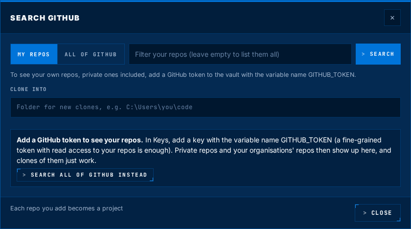</p>

> [!NOTE]
> GitHub search only contacts GitHub when you search. To see private repos, add a GitHub token to the vault with the variable name `GITHUB_TOKEN` (a fine-grained token with read access is enough). KeyVault sends it only to GitHub, never to the browser, and hands it to `git clone` through environment variables, so it is not saved in the cloned repo.

### Inside a project

| To... | Do this |
|---|---|
| Rename it | Click the name at the top and type. Renames are recorded in the activity log. |
| Note where you left off | Type in **Where I left off**. It saves as you type. |
| Plan the work | The **Checklist** tab, above. Rename a phase by clicking its name; edit an item by clicking its title. |
| Change the ID prefix | **ID prefix** on the checklist, for example `RO` for Ranger One. Every item id updates. |
| Open the folder | **Explorer**, **VS Code**, **Cursor** or **Terminal** next to each folder (the ones you have installed). The last one you used becomes what **Resume** does. |
| Link more folders, links or keys | A project can have several folders (say, the app and its API), links (live site, repo, design) and the vault keys it uses. |
| Record progress | **Log it** under Activity. Your AI tools log here too. |
| Hand it to any AI | **Copy brief for any AI** copies a summary with your note, the open checklist items, folders and git status, ready to paste into any chat. |
| Duplicate, archive or delete | Buttons at the bottom. Deleting removes the project from KeyVault only. **Your folders and files are never touched.** |

### Resuming with your AI

Once your AI tool is connected (chapter 07), just tell it:

```
Resume Northwind Storefront from KeyVault
```

It reads where you left off and the open checklist items, works in the project's folders, marks items in progress and done as it goes, and logs what it did here. Next time, you or any other AI tool carry on from there. AI tools can create projects, write and update checklists and log progress, but they can never delete a project, and they only archive a project or start a checklist over when you ask.

<br>

<a id="apps"></a>
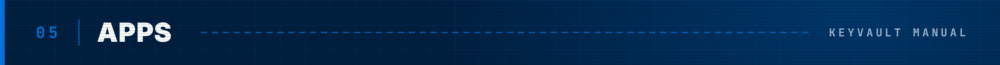

The **Apps** tab shows everything you have running as a wall of cards, the way a streaming service shows films.

<p align="center">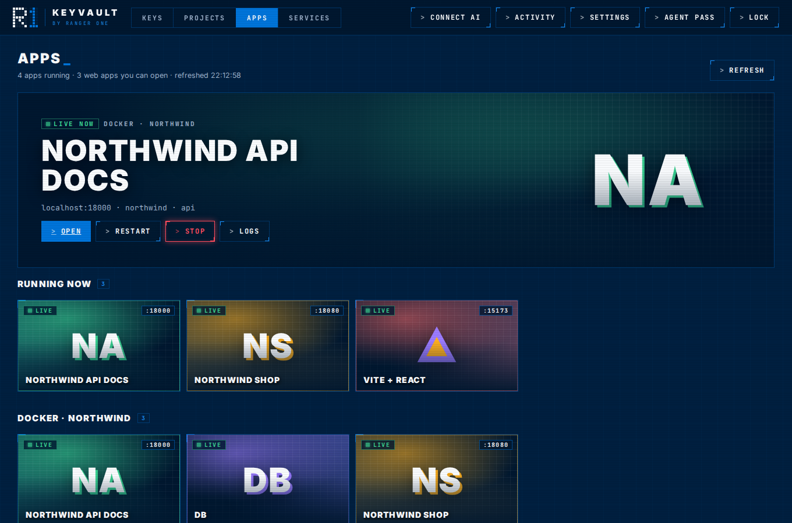</p>

- **The spotlight** at the top is your main running web app, with **Open**, **Restart**, **Stop** and **Logs**.
- **Running now** holds every web app you can open, whether it is a dev server you started in a terminal or a Docker container.
- **One row per Docker compose project**, stopped containers included, so you can start them again from here.
- **Other services** are running programs that are not web pages, such as databases.

Each card shows the app's own icon when it has one (fetched from the app itself, on your machine), otherwise its initials. The green **Live** light means it is running, and the badge shows its port.

<p align="center">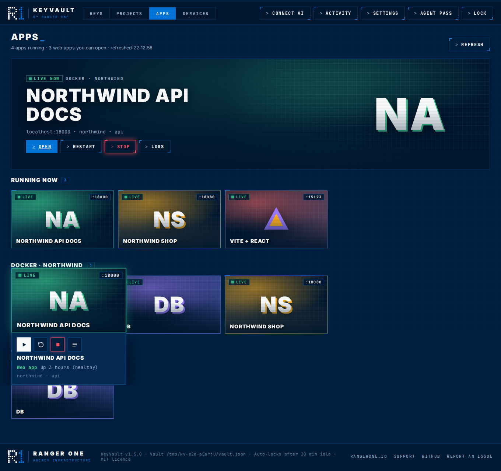</p>

**Hover a card** (or tab to it) and it grows to show its actions: ▶ open, restart, stop (red) and logs. Click the card itself to open the app. Scroll a row sideways with the arrows, your trackpad or Shift and the mouse wheel. On a phone or tablet the actions are always visible.

<br>

<a id="services"></a>


<p align="center">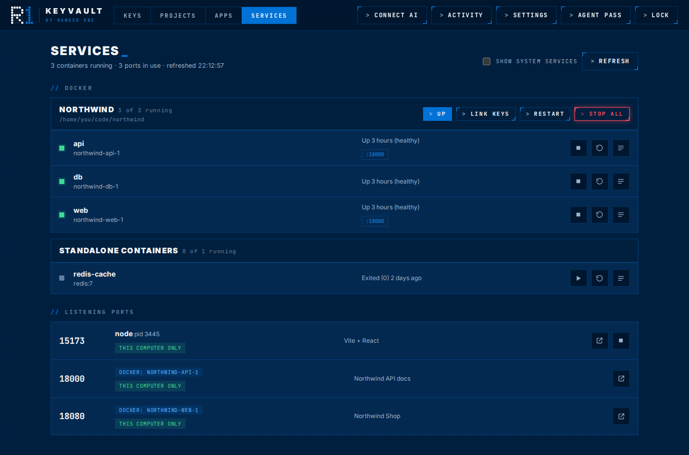</p>

The **Services** tab is the detailed view. It refreshes every few seconds and shows:

- **Docker containers**, grouped by compose project, with status, published ports (click to open), start, stop, restart and logs. **Start all** glows green and **Stop all** glows red. Buttons show what they're doing ("Stopping…") until Docker answers, and if a container fails you are told which one and why. Works with Docker Desktop on Windows and macOS, Docker Engine on Linux, Colima, OrbStack and Rancher Desktop. Set `DOCKER_HOST` if yours lives somewhere unusual.
- **Listening ports**: every program on a TCP port, which process owns it, whether it is reachable only from **this computer** or is **open to your network**, and the page title if it serves a website. Stop a stray dev server with one click. System services stay hidden unless you tick **Show system services**.

### Starting a compose project with keys

1. In your `docker-compose.yml`, reference keys as variables:
   ```yaml
   services:
     api:
       environment:
         ANTHROPIC_API_KEY: ${ANTHROPIC_API_KEY}
   ```
2. In **Services**, click **Link keys** on the project and choose which vault key fills each variable.
3. Click **Up with keys**. KeyVault runs `docker compose up -d` in the project folder with those keys in the environment. No `.env` file is written.

KeyVault learns the project folder from the labels Docker adds when a project is first started with `docker compose`, so start it the normal way once.

<br>

<a id="connect-your-ai"></a>


KeyVault includes an MCP server. Once it's configured, your AI tool starts it by itself. You never run it yourself. The exact config for your machine, with the right paths, is under **Connect AI** in the app, or:

```sh
keyvault config               # all tools
keyvault config claude-code   # just one
```

<p align="center">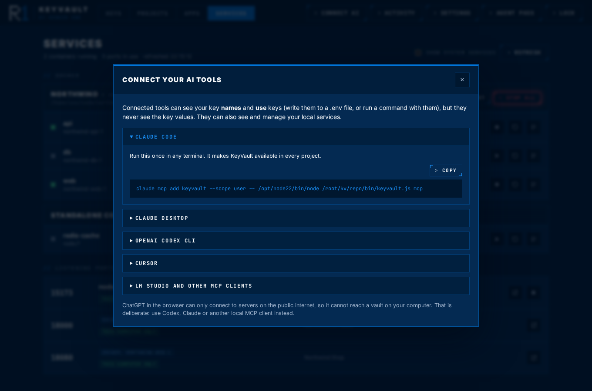</p>

| Tool | How to connect |
|---|---|
| **Claude Code** | Run the `claude mcp add keyvault ...` command that `keyvault config claude-code` prints. It works in every project. |
| **Claude Desktop** | Settings > Developer > Edit Config. Add the `keyvault` entry under `mcpServers`, save, then fully quit and reopen Claude. |
| **OpenAI Codex CLI** | Add the `[mcp_servers.keyvault]` block to `~/.codex/config.toml`. |
| **Cursor** | Add the entry to `~/.cursor/mcp.json`, or Settings > MCP > Add new server. |
| **LM Studio and other MCP clients** | Most clients, LM Studio included, use the same `mcpServers` JSON format. |

The generated config uses absolute paths, which avoids the usual "command not found" trouble with desktop apps. If you move or reinstall KeyVault, run `keyvault config` again and update it.

> [!NOTE]
> ChatGPT in the browser can only reach MCP servers on the public internet, so it cannot see a vault on your computer. That is by design. Use Codex CLI, Claude, Cursor or another local MCP client.

### What your AI can do

| Tool | What it does | Needs the vault unlocked |
|---|---|---|
| `vault_status` | Is KeyVault running and unlocked? | No |
| `verify_package` | Checks a dependency name against the pinned Trend Micro Python hallucination dataset and official PyPI registry, or checks npm registry existence. A dataset match is a hard stop; registry presence is not a safety approval. | No |
| `list_keys` | Key names, organisation, provider, env var name, status, expiry, notes. **Never the values.** | Yes |
| `write_env_file` | Writes chosen keys into a `.env` file and adds it to `.gitignore` if it is in a git repo. Replies with variable names only. | Yes |
| `run_with_secrets` | Runs a command with keys set as environment variables. Any key value in the output is replaced with `[KEYVAULT:NAME]`. | Yes |
| `open_vault` | Opens KeyVault in your browser, for example so you can add a missing key yourself. | No |
| `list_services` | Docker containers and listening ports. | No |
| `service_logs` | Recent container logs, with every stored key scrubbed out. | Yes |
| `container_action` | Start, stop or restart a container. | Yes |
| `compose_up_with_keys` | `docker compose up -d` for a project, with its linked keys injected. | Yes |
| `free_port` | Stops the program holding a port (never Docker containers or system services). | Yes |
| `list_projects` | Your projects, most recently worked on first, with where you left off, checklist progress and the next item. | Yes |
| `get_project` | The full brief to resume a project: your note, open checklist items by phase, folders with git status, links, key names, recent activity. | Yes |
| `create_project` | Creates a project, by default for the folder the AI is working in, optionally with a starting checklist. | Yes |
| `update_project` | Renames, changes status or notes, adds folders. Cannot delete. | Yes |
| `get_checklist` | The full checklist, every item with its id, status, owner and notes, filtered by phase or status if asked. | Yes |
| `add_checklist_items` | Adds phases and items, for example to write the plan for a new project. | Yes |
| `update_checklist_items` | Sets items in progress, done, blocked or superseded, changes owners and notes. | Yes |
| `log_progress` | Records what was done and where to pick up next time. | Yes |
| `open_project` | Opens a project folder in Explorer, VS Code, Cursor or a terminal. | Yes |

Every action that uses a key or changes a service is recorded in **Activity**, inside your encrypted vault. Your AI tool may also ask you to approve each call, depending on its settings.

Before proposing or installing a dependency found online, ask your AI tool to call `verify_package` with the exact package name. A Trend Micro dataset match hard-blocks that exact name and must not be overridden by search results. The pinned dataset records Python module names, which may differ from distribution names; verify a distinct canonical distribution name separately. The dataset does not cover npm. A registry match confirms only that a name exists, not that the package is safe or trusted. KeyVault never installs packages.

KeyVault bundles the [Trend Micro slopsquatting reference snapshot](data/README.md) under its MIT licence. It is pinned to an upstream commit and checked by hash during standalone executable builds.

> [!TIP]
> A `.env` file is plain text. If your AI tool can also read files by itself (Claude Code and Codex can), it could open a `.env` that KeyVault wrote, and the keys would then be in the chat. Where you can, prefer `run_with_secrets` or **Up with keys**, which never put keys in a file.

Things you can say to your assistant:

- "Set up a `.env` for this project with the Anthropic and Supabase keys from KeyVault."
- "Run the integration tests with the Stripe test key."
- "Port 3000 is taken, free it up."
- "Why is the api container failing? Check its logs."
- "Write a build checklist for the Ranger One website in KeyVault."
- "Resume the Ranger One website project." Then, at the end: "Log what we did and update the checklist."

If your AI ever asks you to paste a key into the chat, tell it to use KeyVault instead.

<br>

<a id="backups"></a>


Your vault is one file: `~/.keyvault/vault.json` (on Windows, `C:\Users\<you>\.keyvault\vault.json`). KeyVault keeps the previous version beside it as `vault.previous.json`, but that won't save you if the disk dies.

**Settings > Download encrypted backup** saves a copy encrypted with your master password, so it is safe in OneDrive, Google Drive or on a USB stick. The Keys page shows when you last backed up.

To restore, on the same or a new computer: open KeyVault, choose **Restore from a backup file**, pick the file, then unlock it with the master password that was in use **when that backup was made**. After changing your master password, download a fresh backup.

<br>

<a id="how-it-works"></a>
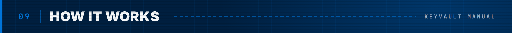

```
 Browser ──(session token in a header)──┐
                                        ▼
                         ┌──────────────────────────┐        ~/.keyvault/vault.json
                         │  KeyVault  127.0.0.1     │◀──────▶ AES-256-GCM, key from your
                         │  holds the unlocked      │         password via PBKDF2 (600k)
                         │  vault in memory         │
                         └──────────────────────────┘
                               ▲                 │
              (agent token)    │                 └──▶ Docker Engine API, OS port list
 Claude / Codex / Cursor ──────┴── keyvault mcp (stdio)
```

- **Encryption.** AES-256-GCM. The key comes from your master password through PBKDF2-HMAC-SHA256 at 600,000 iterations (the OWASP recommendation), with a random 16-byte salt and a fresh 12-byte nonce on every save. Any tampering with the file is detected.
- **One background process** listens on `127.0.0.1` only, on port 47821 (or a free port if that one is taken). It checks the `Host` header to block DNS rebinding and serves a strict Content Security Policy.
- **Your browser** signs in with a one-time link, valid for 2 minutes. That gives it a session token kept in the page's own storage, which other sites and other localhost ports cannot read, and sent in a custom header, never a cookie. KeyVault stores only a SHA-256 hash of each session, so a restart doesn't sign you out and the file on disk can't be used to sign in. A session never unlocks the vault. That always takes the master password.
- **AI tools** go through `keyvault mcp`, which talks to the background process with a random token in `~/.keyvault/agent.json`. Nothing reachable with that token returns a key value or a browser login, and all command output and logs are scrubbed of **every** key in the vault, not just the ones used.
- **Wrong passwords** trigger an increasing delay after five attempts.

Read [SECURITY.md](SECURITY.md) for what KeyVault protects against, and what it does not.

<br>

<a id="reference"></a>


```
keyvault               Open KeyVault (starts it in the background if needed)
keyvault status        Is KeyVault running and unlocked?
keyvault lock          Lock the vault now
keyvault stop          Stop KeyVault
keyvault config [app]  Setup for claude-code, claude-desktop, codex, cursor, lm-studio
keyvault mcp           The MCP server (your AI tool starts this)
keyvault serve         Run in this window instead, for troubleshooting
keyvault --version
```

| Environment variable | Purpose |
|---|---|
| `KEYVAULT_HOME` | Folder for the vault and its files. Default `~/.keyvault`. |
| `KEYVAULT_PORT` | Use this port instead of 47821. `0` means any free port. |
| `KEYVAULT_NO_BROWSER` | Set to `1` to stop KeyVault opening a browser. |
| `DOCKER_HOST` | Where Docker is, if not the default (`unix://...`, `npipe://...` or `tcp://...`). A `tcp://` address on another machine is one case where KeyVault talks over the network. The other network calls happen only when requested: **Search GitHub** contacts GitHub, and `verify_package` contacts the official PyPI or npm registry. |

<br>

<a id="troubleshooting"></a>


**"This window is no longer connected".** This browser isn't signed in yet, or was signed out. Double-click KeyVault.exe (or run `keyvault`) to sign in, and every KeyVault tab in that browser works. If the page says KeyVault has stopped, start it again and the page reconnects by itself.

**The browser doesn't open** (on a server with no desktop, say). Run `keyvault stop`, then `keyvault serve`. It prints a one-time login link to paste into a browser, and a fresh one each time you press Enter.

**My AI tool says KeyVault is locked.** Unlock it in your browser (the AI tool opens it for you), then ask again. Only activity in KeyVault keeps it unlocked, not AI tool use.

**The AI tool can't find KeyVault.** If you moved KeyVault.exe after connecting, open **Connect AI** again and update the path in your tool's config. Restart the AI tool fully after changing its config. On Claude Desktop, check **Settings > Developer** for errors.

**Apps or Services say Docker is not available.** Start Docker Desktop (or the Docker service), then press **Refresh**. On Linux, your user must be in the `docker` group.

**A Docker button reports a failure.** The message names the container and gives Docker's reason, such as a port already in use. Fix that, then try again.

**A project says "Folder missing".** The folder was moved, renamed or is on a drive that isn't plugged in. Open the project, remove the old folder and add the new location. Nothing else about the project changes.

**Find my repos doesn't find a repo.** It looks two levels deep in your usual code folders. Type the folder that contains your repos into **Also look in another folder**.

**A port shows "Another user's program".** It belongs to another account (often root). KeyVault can see the port is in use but can't see or stop the program.

**I forgot my master password.** It can't be recovered. If you have an older backup and remember the password in use back then, you can restore that.

**Where are the logs?** `~/.keyvault/daemon.log`. They never contain key values.

<br>

<a id="contribute"></a>


KeyVault is free and open source under the [MIT licence](LICENSE). Use it, change it, ship it in your own products. Keep the copyright notice.

```sh
npm install              # test tools only: KeyVault itself has no runtime dependencies
npm test                 # unit and integration tests (Node's built-in runner)
npx playwright test      # browser tests
npm run build:exe        # standalone executable in dist/
```

The tests start a real KeyVault and a real MCP session, and check that key values never reach the AI side, that the vault file never contains plain text, and that the UI works end to end, including at phone width.

Principles for contributions are in [CONTRIBUTING.md](CONTRIBUTING.md). In short: no runtime dependencies, no network calls unless you ask for one (like **Search GitHub**), and keys never leave the local process in a way an AI can read. Found a security problem? Please follow [SECURITY.md](SECURITY.md) rather than opening a public issue.

<br>

<p align="center">
  <a href="https://rangerone.io">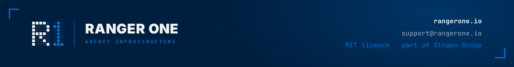</a>
</p>
